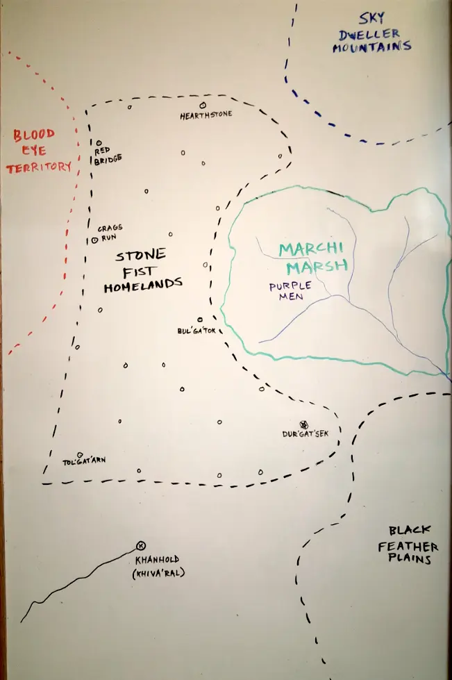

# Tribal Lands

These areas extend out from beyond Khanhold and are the homes of various tribal people. Previously left to their own, recent events surrounding our adventurers and the invasion have caused tighter rule and required fealty to Khandaria and the Khan.

Tribes:
- Stone Fist
- Black Feathers
- Blood Eye
- Purple Men
- Sky Dweller

  
_A map of tribal lands north of Khanhold_  

## Stone Fist

These tribal warriors aligned themselves with the adventuring party at Khanhold, with the promise of trade of glass from `Pylia`. Their homelands span the areas of Khanhold and are between the Blood Eye territory and the Marchi Marsh of the Purple Men.

They can be seen to travel everywhere on foot, running across great distances. The pride great strength in their warriors, fighting often in melee with their fist and with gauntlets. Their individual villages have chiefs but the head of all Stone Fist is the chief in Dur'gat'sek. The honor the magic and wisdom of shaman such as `Qa'dat` but they have little direct authority over the tribe.

They see the Black Feathers as weak, often raiding their villages as the Stone Fist are strong and opportunistic raiders. Until recently, part of their raids included capturing women to act as slaves, a practice under terms with the Khan can no longer continue to which the head chief has reluctantly agreed.

## Black Feathers

Primary tribe aligned with `Wernick` in attacking Khanhold after the party resettled the town. Brought quickly to heel after the battle by `Khan Magnus` and have started to integrate, including an assistant to `Cedric` in his restaurant before the invasion. Known for their skill on horseback and use of bow and arrows.

## Blood Eye

Viscious orc tribe in the north west of dedicated raiders and slavers. Often deals with infighting between villages. Currently weakend by such fighting after the party drove them out of the remains of the village that became Khanhold. `Pylia`'s father was discovered to be an orc chieftan at that battle.

## Purple Men

Tribe of men with purple skin from tattoos that dwell in the Marchi Marsh. Not much is known as their marsh is said to be dangerous and none ever come out who venture in. Some of their shamans participated in the battle against Khanhold as well as with the armies against Ur'gench. `Shag'nurab` betrayed the party and used an artifact to take out magic schools inside Ur'gench before he was found and killed. Currently `Khan Soren` as sent a party to bring him the leaders of the Purple Men to bring them under Khandarian rule by force.

## Sky Dweller

Fairly isolated mountain dwelling tribe to the north. They have expert rock climbing abilities. They are good aligned and tried with the Stone Fist but still have no relations with the Khan.

[_return to locations_](/locations/)  
